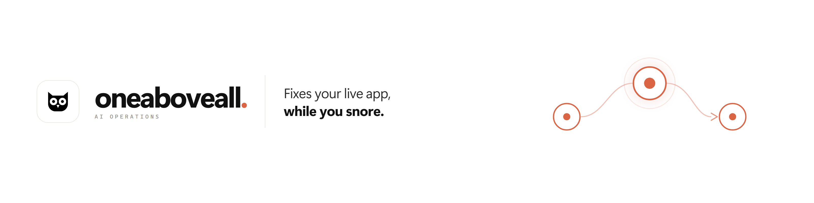
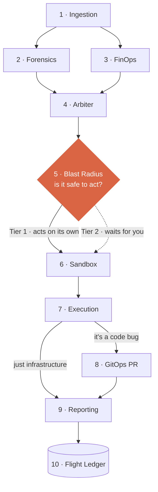

<div align="center">
  
</div>

<br/>

**OneAboveAll (OAA)** is an autonomous SRE control plane with *graduated trust*.

When production breaks at 3 AM, OAA doesn't just page you — it diagnoses the incident,
argues about the right fix, scores how dangerous that fix is, and then either acts on its
own, asks you first, or opens a pull request. Every move is recorded and replayable.

The point isn't "an AI fixes your server". It's **an AI that knows when it shouldn't** —
and hands control back to you, on a schedule you can see.

---

## The 3 AM problem

A database lock takes down checkout. By the time someone wakes up, opens six dashboards and
works out which of 400 pods is the problem, twenty minutes are gone.

OAA compresses that into **under twenty seconds** — and it does it without a human in the
loop for the easy 80%.

---

## Three levels of trust

| | What happens | Who decides |
| :--- | :--- | :--- |
| **Tier 1** | Restart a pod, flush a cache. Reversible, stateless, small blast radius. | **OAA acts alone.** No one is woken up. |
| **Tier 2** | Anything touching a database, or more than a quarter of the fleet. | **You decide.** OAA pauses, shows a 3-line briefing, waits for your click. |
| **Tier 3** | The root cause is a bug in your code. | **Nobody hot-patches production.** OAA writes a tiny patch, proves it with tests in a sandbox, and opens a pull request. |

That last one matters. A 3 AM agent with write access to production source is a worse
disaster than the outage it's fixing.

---

## Real math decides — not the AI

Three specialised models argue about the fix: one on speed, one on cost, one to settle it.

**None of them decides whether the fix is safe.**

That's a plain arithmetic score called the **blast radius**, computed from three honest
questions: how many servers are we touching, is there data at stake, and how hard is this
to undo.

If the number is too high, everything stops. LLMs can hallucinate — arithmetic can't.

---

## The 3-strike rule

You wouldn't want an agent to keep guessing, retrying, and making things worse.

So if a fix fails three times, OAA stops on its own: it revokes its own write access,
withholds the patch, and hands you the ticket. You get exactly **one** manual retry — for
that ticket, that time, with your hint attached.

No infinite loops. No "let me try something else".

---

## How a run works



**1 · Ingestion** — Pulls the real evidence: CPU, memory, database pool, container logs.

**2 · Forensics** — Argues for the fastest way to stop the bleeding.

**3 · FinOps** — Argues back about cost, quotas, and what must not be touched.

**4 · Arbiter** — Settles the argument into one concrete decision.

**5 · Blast Radius** — Does the maths on how dangerous that decision is.

**6 · Sandbox** — Dry-runs the fix before it's allowed anywhere near production.

**7 · Execution** — The only step with write access. This is where the fix actually lands.

**8 · GitOps PR** — If the cause was a bug, writes a tiny tested patch and opens a pull request.

**9 · Reporting** — Writes the story: what happened, what was done, what it cost.

**10 · Flight Ledger** — Records everything permanently, so any run can be replayed later.

> Only step 7 can change anything. Everything upstream is read-only by design.
> Built with FastAPI, LangGraph, FastMCP and Next.js — see `architecture.md` for the wiring.

---

## See it run

Two terminals. You need **Node 18+** and **[uv](https://docs.astral.sh/uv/)**.

```bash
# terminal 1 — the brain
cd backend
uv sync
uv run uvicorn app.main:app --host 127.0.0.1 --port 8000
```

```bash
# terminal 2 — the control room
cd frontend
npm install
npm run dev
```

Open **http://localhost:3000**. Everything runs offline.

---

## The 60-second demo

| Do this | Watch this |
| :--- | :--- |
| **Simulate outage → S1** (stateless memory leak) | Ten nodes light up in ~2.5s. Nobody is paged. Silent overnight fix + a Morning Digest. |
| **Simulate outage → S2** (database lock) | The screen turns amber and waits for you. Read the briefing, hit **Approve & execute** — recovery resumes live. |
| **Simulate outage → S3** (pricing bug) | Service is stabilised in seconds, then a **pull request** appears. The bug gets fixed properly, in daylight. |
| **Open `/history` → INC-4815 → "Run 4th try"** | A ticket stuck at 3/3 failures gets rescued on your command. Watch it walk from halted to resolved. |
| **Open `/config` → switch `restart_pod` off → run S1** | The run refuses to proceed — and says why. Governance isn't decoration. |

Same inputs, same story, every time.

---

## Four screens

| | |
| :--- | :--- |
| **Dashboard** — the War Room | Live telemetry, the three agents arguing, the human-approval gate, and the risk gauge — all in one glance. |
| **History** — the Blackbox | Every incident, replayable node by node, with the exact state at every step. Plus the manual 4th-try rescue. |
| **Config** — the Control Room | How much authority OAA gets, and which tools it's allowed to touch. Change it, and the next run obeys. |
| **Support** — the Watchman | Four one-click fixes for OAA itself, and an honest FAQ. |

---

<div align="center"><sub>Built for the hackathon · runs fully offline · <code>MOCK_ENV=true</code></sub></div>

> **Important — offline shield:** a lot of the code in this repo is deliberately dormant.
> It is the structure for a live API to be built upon. The app is **mock-only** right now —
> the LLM clients are wired but never called, the Docker sandbox is coded but not engaged,
> and every incident comes from deterministic fixtures. Real cluster adapters, real model
> calls and a real sandbox drop into those seams without changing the graph. This build
> exists to present the **idea** at this hackathon, end to end and offline.
